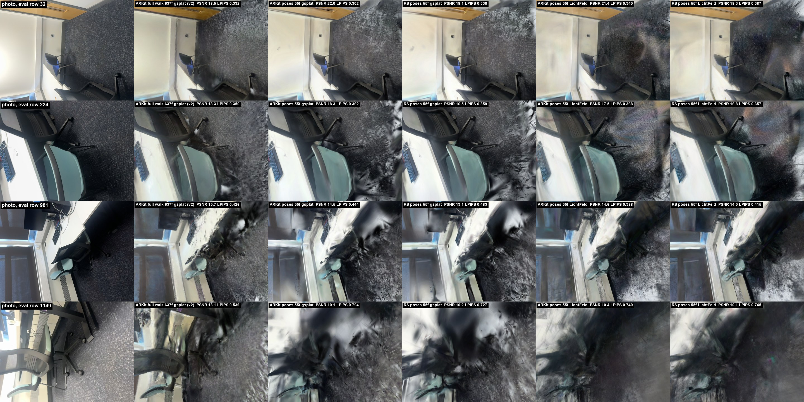

# RealityScan 2.2 vs ARKit poses: atrium

> **Internal research only.** RealityScan's EULA forbids offering it as a hosted service. It runs here
> only as an ephemeral `modal run` of `deploy/modal/realityscan/app.py` for paper experiments. It is
> not wired into the room call or any endpoint. The .deb lives only on the private Modal Volume
> `litereality-tools`.

## What ran

- **RealityScan 2.2:** the Linux build (a CrossOver/Wine bundle) runs headless on Modal on a **CPU-only
  gVisor container** (8 CPU, 16 GB) under Xvfb, with no Epic login (the `eosLoginType=2` registry skip)
  and no GPU. It does alignment (SfM) only and exports COLMAP text. The recipe and its gotchas are in
  `deploy/modal/realityscan/app.py`. Smoke test: 10 frames, 8 registered, 18 s.
- **Stray capture** (LiDAR iPhone, ARKit odometry): we gave RealityScan 400 frames from the pool import,
  including the 29 fixed eval frames, which were kept out of training.
- **Normal video** (`atrium_video.MOV`, 4K HEVC, rotated to portrait 1080x1920): we gave RealityScan
  388 extracted frames.
- **Scoring:** every splat is scored by `results/stray_quality/score.py`, unchanged, on the **same 29
  Stray eval frames**, using the same Spark/SwiftShader renderer, 480x360, and PSNR/SSIM/LPIPS. The
  wrapper `scripts/realityscan/score_rs.py` only redirects the output to `scores/`.

## Pose agreement: RealityScan vs ARKit (Stray capture)

RealityScan **does not reconstruct this room as one piece**. The walk passes close to white walls and
dark blinds, so many frames have few usable features.

| RealityScan setting (400 frames) | Components | Largest component | Agreement with ARKit (Sim(3) fit) |
|---|---|---|---|
| Smoke, 10 consecutive frames | 1 | 8 frames | Centres 8.5 mm RMSE over a 12 cm extent. Rotation 0.32° median / 0.73° max (orientation fit). fx 1338.8 vs ARKit 1335.5 (+0.25%) |
| Default | 23 | 60 frames (5 eval frames) | Centres 11 mm median / 24 mm p90 over a 1.4 m extent. Rotation 0.9° median with the orientation fit, 1.9° with the centre+axis fit. 1 s relative rotation 0.59° median. fx within 0.36% of ARKit |
| Ultra detector, Low overlap, second align | 25 | 75 frames | **Wrongly merged:** 6 cm and 6–11° median error |
| ARKit pose priors (±10 cm / ±5° XMP) and merging | 22, placed by the priors | 221 frames | **Unusable:** pieces keep their own focal lengths (one at 615 px), rotations off by up to 85° |

Where RealityScan does register frames (default settings), its poses agree with ARKit to about 1 cm and
about 1°, and it recovers the focal length within 0.4%. So the two pose sets are consistent but not
identical, and the 1–2° rotation disagreement is enough to matter for photometric scores (below).
Details: `stray/pose_vs_arkit_*.json`, `summary.json`.

**Video:** RealityScan registered 102 of 388 frames, split into 9 pieces (96 with the stronger
settings). It put fx at about 1539 px; a LiDAR PnP check elsewhere says 1579 px. None of its
reconstructions could be placed in the room. Every Sim(3) fit to the Stray LiDAR cloud was ambiguous:
the default run had 54% inliers, and its runner-up hypothesis differed by 14° yaw and 0.8 m. Camera
heights came out at 0.8–1.0 m against 1.6 m. With MapAnything priors the focal lengths ranged from
514 to 2217 px. See `video/registration_*.json`.

## Photoreal quality

The only RealityScan reconstruction good enough to train on is the **60-frame default piece**: 55
training photos after removing its 5 eval frames. We trained both arms on **the same 55 photos and the
same RealityScan SfM seed points**, mapped into the room frame by Sim(3):

- **RS arm:** RealityScan poses and lens, with the photos undistorted to PINHOLE.
- **ARKit arm:** ARKit poses and K on the original photos.

Neither arm has dense depth, so gsplat uses only its sparse SfM-point depth loss. The full-walk ARKit
splats from the other workflows are the baselines.

**Scoring at the shared protocol (ARKit eval poses).** Columns:

- **29 eval:** the whole fixed eval set.
- **5 in-piece:** eval rows 32, 116, 224, 308 and 981, the only eval frames inside RealityScan's piece,
  computed from the same per-view renders.
- **5 at RS poses:** the same 5 frames at RealityScan's own poses for them, with RealityScan's K and
  undistorted photos. This takes the ARKit-vs-RS pose disagreement out of the score.
- **GPU $:** estimated from trainer seconds at the Modal GPU rate.

| Capture | Poses | Train frames | Trainer | 29 eval: PSNR / SSIM / LPIPS | 5 in-piece (ARKit poses) | 5 in-piece (own RS poses) | Train s | GPU $ |
|---|---|---|---|---|---|---|---|---|
| Stray full walk | ARKit | 188 | gsplat 5k + LiDAR/PromptDA dense depth (v0) | 19.15 / 0.738 / 0.286 | 17.08 / 0.637 / 0.355 | - | 152 | 0.19 |
| Stray full walk | ARKit | 637 | gsplat 10k + dense depth (v2, current best) | **20.19 / 0.767 / 0.262** | 18.60 / 0.690 / 0.303 | - | 588 | 0.65 |
| Stray full walk | ARKit | 188 | LichtFeld mcmc 30k | 18.74 / 0.727 / 0.332 | 15.30 / 0.634 / 0.432 | - | 273 | 0.30 |
| Stray RS piece | ARKit | 55 | gsplat 5k, 960 px | 12.19 / 0.631 / 0.574 | **19.50** / 0.717 / 0.318 | - | 58 | 0.06 |
| Stray RS piece | RealityScan | 55 | gsplat 5k, 960 px | 11.44 / 0.599 / 0.583 | 17.27 / 0.549 / 0.350 | 18.63 / 0.728 / 0.316 | 58 | 0.06 |
| Stray RS piece | RealityScan | 55 | gsplat 5k, 1920 px | 11.62 / 0.601 / 0.584 | 17.54 / 0.554 / 0.349 | 19.10 / **0.731** / 0.312 | 102 | 0.11 |
| Stray RS piece | ARKit | 55 | LichtFeld mcmc 30k, 960 px | 12.57 / 0.634 / 0.560 | 18.93 / 0.700 / 0.311 | - | 468 | 0.27 |
| Stray RS piece | RealityScan | 55 | LichtFeld mcmc 30k, 960 px | 12.21 / 0.615 / 0.560 | 17.23 / 0.569 / 0.338 | 18.75 / 0.724 / **0.305** | 476 | 0.28 |
| Video | RealityScan | - | not trained | - | - | - | - | - |

- **Trainer's own held-out views** (1 in 8 of the 55 photos, each arm at its own poses):
  | Run | PSNR / SSIM / LPIPS |
  |---|---|
  | RS gsplat 5k, 960 | 23.71 / 0.865 / 0.228 |
  | ARKit gsplat 5k, 960 | 23.52 / 0.818 / 0.249 |
  | RS gsplat 5k, 1920 | 23.82 / 0.866 / 0.238 |
  | RS LichtFeld | 29.61 / 0.909 / 0.137 |
  | ARKit LichtFeld | 28.41 / 0.855 / 0.168 |
- **Row data:** `table.json`, built by `scripts/realityscan/make_table.py`. Per-view rows and eval sheets
  are in `scores/`. The earlier 6000-step gsplat runs (`*_pure_gs`) agree within about 0.5 dB.

**Same-angle comparison** (`compare.jpg`, from `scripts/realityscan/compare_image.py`):

- Columns: the photo, the full-walk ARKit v2, then gsplat and LichtFeld on the 55-frame piece with ARKit
  and with RealityScan poses.
- Rows: eval rows 32, 224 and 981, which are inside the piece, and row 1149, which is outside it.
- All views are at the ARKit eval pose.

## Conclusions

1. **RealityScan cannot replace ARKit for this room.** Out of the box it reconstructs only 15% of the
   walk (60 of 400 frames) as its largest piece. Stronger settings merge pieces wrongly, and ARKit
   priors produce inconsistent intrinsics and rotations off by up to 85°. ARKit tracks the whole walk.
   So on the full 29-frame eval set, every RS-piece splat (about 11.4–12.6 dB) is far below the
   full-walk ARKit splats (18.7–20.2 dB). That is a coverage failure: 24 of the 29 eval views lie
   outside the piece. Both arms of the piece experiment fail equally there.
2. **Where it does register, RealityScan agrees with ARKit to about 1 cm and about 1°.** The two pose
   sets are consistent but not identical.
3. **RealityScan poses train slightly sharper splats on their own terms:**
   - On the trainer's held-out views, the RS arm wins with both trainers: SSIM +0.05, LPIPS −0.02 to
     −0.03, PSNR +0.2 dB (gsplat) and +1.2 dB (LichtFeld).
   - On the 5 eval frames at each arm's own poses, the picture is mixed: RS has better SSIM and LPIPS,
     about equal PSNR.
   - This fits a self-consistent bundle adjustment with a calibrated lens beating ARKit's per-frame odometry.
   - Both arms share the same photos and seeds. The ARKit arm is slightly handicapped: its seed points
     come from RealityScan, about 13 px off at 960 px.
4. **Under the shared protocol (ARKit eval poses), RS-pose splats lose 1.7–2.2 dB** (17.2–17.5 vs
   18.9–19.5 on the 5 in-piece frames). That is not worse quality. It is the 1–2° frame disagreement
   between the two pose sets: a splat trained in RS's frame is viewed from slightly wrong cameras.
   Comparing pose sources fairly means rendering each at its own registration of the held-out views.
   The 1920 px RS run is only marginally better than 960 px (+0.3–0.5 dB).
5. **The normal video gives nothing usable.** RealityScan registers about 26% of frames in 9 pieces, and
   none of them can be placed in the room unambiguously. So there is no video training run and no score
   at Sim(3)-aligned eval poses. We did not report a wrongly placed number instead.
6. **The evidence is small.** There are only 5 overlapping eval views, and the arms differ in
   undistortion and K as well as poses. Treat point 3 as a hint, not a result. The paper-worthy finding
   is coverage: RealityScan's SfM is more accurate per registered frame, but it fails to connect this
   feature-poor room. ARKit's visual-inertial odometry never loses tracking, so the room-scale pipeline
   should keep ARKit poses. RealityScan or COLMAP-style refinement could at most polish poses locally.

## Spend

| Item | Cost |
|---|---|
| RealityScan alignment containers (CPU) + debugging, smoke step | under $1 |
| Alignment step (all RealityScan runs, the 6000-step gsplat runs, the LichtFeld runs, debugging; ephemeral $2.51 → $4.28) | about $1.77 |
| This step: 3 gsplat runs on H100 (58 + 58 + 102 s) | about $0.24 (ephemeral total $4.28 → $4.63; this includes another workflow's `litereality-splat-debug` app) |
| **Total for the RealityScan job** | **about $3**, within the $5 budget |

- **Scoring:** all scoring and image rendering ran locally on CPU (SwiftShader), at no Modal cost.
- **Running apps:** none. The leftover detached app `ap-IifcBpu7aEocIsG76YnBFi` had already stopped by
  itself.
- **Modal metered total:** now $14.27, mostly other workflows' deployed apps.

## Files

- **Modal app:** `deploy/modal/realityscan/app.py` (RealityScan) and `deploy/modal/realityscan/train_splat.py`
  (gsplat via the deployed trainer).
- **Scripts:** `scripts/realityscan/`
  - Data prep: `prep_*`, `stray_poses.py`, `video_register.py`, `write_priors.py`, `build_dataset.py`.
  - Training and scoring: `train_rs.py`, `score_rs.py`, `make_table.py`, `compare_image.py`.
- **Runs:** `run/realityscan/{rs,arkit}_stray_gs5k`, `rs_stray_gs5k_w1920`, `{rs,arkit}_stray_pure_{gs,lfs}`.
- **Datasets:** `~/LiteReality-scans/rs_stray/{rs,arkit}_w{960,1920}.tar.gz`.
