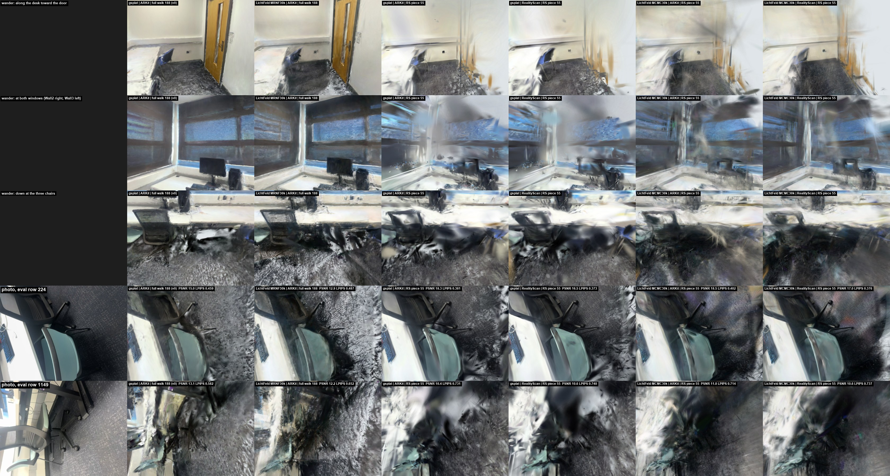

# Trainers and pose sources on the atrium: gsplat vs LichtFeld Studio, ARKit vs RealityScan poses

**Verdict: keep what the pipeline already does: ARKit poses plus our gsplat trainer
(`deploy/modal/splat`).** Neither LichtFeld Studio nor RealityScan beats it on the shared eval.
RealityScan also cannot be used in a served pipeline (EULA), and it covers only 15% of this walk.

## One table: same 29 eval frames, same renderer

- **Eval frames:** the 29 fixed frames in `results/stray_quality/eval_frames.txt` (recording 901a305fdf).
  No run trained on any of them (see Fairness).
- **Scorer:** `results/stray_quality/score.py`, unchanged, used for every row.
- **Renderer:** Spark 2.3.1 on three.js 0.180, headless Chromium with SwiftShader, SH degree 1 for every
  splat. Metrics are at 480x360, rendered at 2x and box-filtered.

Columns:

- **29 eval:** all 29 frames at their ARKit pose. PSNR cc is PSNR after a per-view colour fit.
- **5 in-piece:** the only eval frames (rows 32, 116, 224, 308, 981) inside the 60-frame piece that
  RealityScan could reconstruct, still at ARKit poses.
- **5 at own RS poses:** the same 5 frames at RealityScan's own registration of them, with its K and
  undistorted photos. This removes the 1–2° frame disagreement between the two pose sets.
- **GPU $:** trainer seconds × Modal list price for the GPU it ran on (H100 $3.95/h, A100-80GB $2.50/h,
  A100-40GB $2.10/h, L40S $1.95/h).

| # | Trainer | Poses | Training photos | 29 eval: PSNR / PSNR cc / SSIM / LPIPS | 5 in-piece (ARKit poses): PSNR / SSIM / LPIPS | 5 at own RS poses | Train s (GPU) | GPU $ |
|---|---|---|---|---|---|---|---|---|
| 1 | **gsplat 5k + LiDAR/PromptDA depth (pipeline, v0)** | ARKit | 188, full walk | **19.15** / 21.65 / **0.738** / **0.286** | 17.08 / 0.637 / 0.355 | – | 152 (H100) | 0.17 |
| 2 | LichtFeld MRNF 30k (its default strategy) | ARKit | 188, full walk | 18.85 / **21.80** / 0.725 / 0.288 | 16.51 / 0.629 / 0.375 | – | 515 (A100-40) | 0.30 |
| 3 | LichtFeld MCMC 30k | ARKit | 188, full walk | 18.74 / 20.76 / 0.727 / 0.332 | 15.30 / 0.634 / 0.432 | – | 273 (L40S) | 0.15 |
| 4 | gsplat 5k (sparse SfM depth only) | ARKit | 55, RS piece | 12.19 / 15.91 / 0.631 / 0.574 | **19.50** / **0.717** / 0.318 | – | 58 (H100) | 0.06 |
| 5 | LichtFeld MCMC 30k | ARKit | 55, RS piece | 12.57 / 16.14 / 0.634 / 0.560 | 18.93 / 0.700 / **0.311** | – | 468 (A100-80) | 0.33 |
| 6 | gsplat 5k (sparse SfM depth only) | RealityScan | 55, RS piece | 11.44 / 15.44 / 0.599 / 0.583 | 17.27 / 0.549 / 0.350 | 18.63 / **0.728** / 0.316 | 57 (H100) | 0.06 |
| 7 | LichtFeld MCMC 30k | RealityScan | 55, RS piece | 12.21 / 15.70 / 0.615 / 0.561 | 17.23 / 0.569 / 0.338 | **18.75** / 0.724 / **0.305** | 476 (A100-40) | 0.28 |
| ref | gsplat 10k + dense depth (current best, v2) | ARKit | 637, full walk | 20.19 / 22.53 / 0.767 / 0.262 | 18.60 / 0.690 / 0.304 | – | 588 (H100) | 0.65 |

**Training conditions.**

- **Rows 1–3** train on one identical tar, `run/atrium_trainers/dataset_q206.tar.gz`: 188 photos at
  960 px, 799,992 LiDAR seed points, every 8th photo held out by the trainer.
  - LichtFeld has no metric-depth loss, so it runs without depth. Its `--use-depth-loss` is scale- and
    shift-invariant.
- **Rows 4–7** train on the same 55 photos and the same RealityScan SfM seed points (31,532). The pairs
  differ only in poses and lens:
  - ARKit pose and K on the original photos (`rs_stray/arkit_w960.tar.gz`), or
  - RealityScan pose and K on photos undistorted to PINHOLE (`rs_stray/rs_w960.tar.gz`).
- **Source files:**
  - Rows 1–3: `gsplat_v0_scores.json` and `lfs_*_scores.json` in this folder.
  - Rows 4–7: `results/realityscan/scores/*_e29_scores.json` and `*_sub5_rspose_scores.json`.
  - ref: `results/stray_quality/v2_scores.json`.
- **More LichtFeld variants** on the full walk (5k MCMC, 30k with its calibration and exposure
  correction on) and a gsplat no-depth control are in the next section.

## Same-angle renders: `compare.jpg`

- **Built by:** `scripts/compare_trainers/compare_image.py`. Per-tile numbers are in `compare.json`.
- **Columns:** the photo, then rows 1, 2, 4, 6, 5, 7 of the table.
- **Rows 1–3:** the three shared "wander" cameras of `score.py` (along the desk toward the door, at both
  windows, down at the chairs). They render each run's uncut `raw.spz.bin` with the recording's own
  lens; there is no photo at these cameras.
- **Rows 4–5:** eval rows 224 (inside RealityScan's piece) and 1149 (outside it), at the ARKit pose, with
  per-view PSNR and LPIPS.

**What it shows:**

- **Full walk, gsplat v0 vs LichtFeld MRNF 30k.** From the wander cameras the room looks alike in both:
  door, windows, monitor and chairs. LichtFeld leaves more dark floaters on the carpet and under the
  desk (rows 1 and 3).
- **The 55-photo RS-piece splats.** Gsplat or LichtFeld, ARKit or RealityScan poses, they only hold the
  desk corner that piece saw.
  - The door wall is smeared, and the door itself is gone, leaving orange streaks.
  - The window wall is half fog, and black floaters hang in front of the windows.
  - At eval row 1149, outside the piece, there is nothing recognisable.
- **Inside the piece (row 224),** the piece splats render the chair sharper than the full-walk splats:
  18.3–18.5 dB with ARKit poses against 15.0 dB for v0. The RS-pose versions sit about 1.5 dB lower at
  the ARKit eval pose (16.5–17.0 dB).
- **Small differences between renders.** Per-view numbers here differ from the scorer's by up to about
  0.5 dB (v0 row 1149: 13.1 here, 13.5 in `v0_scores.json`). The SwiftShader render varies slightly
  from run to run, so read per-view differences under 0.5 dB as noise.

## Findings

1. **Trainer: gsplat stays.**
   - **At equal steps (5k), LichtFeld is clearly worse:** MCMC scores 17.79 dB, SSIM 0.680 and LPIPS
     0.431, against 19.15 dB, 0.738 and 0.286 for gsplat.
   - **At 6x the steps (30k):**
     - MRNF matches our 5k gsplat on PSNR cc (21.80 vs 21.65) and LPIPS (0.288 vs 0.286).
     - It stays 0.3 dB lower on raw PSNR and 0.013 lower on SSIM.
     - It takes 3.4x the wall time and costs 1.8x as much.
   - **On the RS piece:**
     - At ARKit poses, gsplat 5k beats LichtFeld 30k: 19.50 vs 18.93 dB on the 5 in-piece frames.
     - At RealityScan poses the two are tied: 18.63 vs 18.75 dB, SSIM 0.728 vs 0.724.
   - **Part of LichtFeld's gap is missing supervision:** our LiDAR depth losses are worth about 0.2 dB and
     0.016 SSIM (gsplat_v0 vs gsplat_nodepth5k, below).
   - **LichtFeld's own eval is optimistic** (23.6–29.6 dB on its interleaved hold-out). Only the shared
     scorer ranks runs.
2. **Poses: ARKit stays.**
   - **Coverage is the problem.** RealityScan 2.2 registered only 60 of 400 frames in its largest
     component, out of 23 components.
     - Stronger settings merged pieces wrongly: 6 cm and 6–11° off.
     - ARKit-prior runs had rotations up to 85° off.
   - **On all 29 frames, every RS-piece splat scores 11.4–12.6 dB** against 18.7–19.2 dB for the
     full-walk ARKit splats. That is coverage, not image quality: 24 of the 29 eval views lie outside the
     piece.
   - **Where it registers, it agrees with ARKit:** centres to about 1 cm, rotations to about 1–2°, focal
     length within 0.36%.
     - At its own poses its splats are about as good as the ARKit arm on those 5 frames: SSIM 0.728 vs
       0.717, PSNR 18.6 vs 19.5.
     - Five frames is a hint, not a result.
   - **Comparing pose sources at ARKit eval poses penalises RealityScan by 1.7–2.2 dB.** That is the frame
     disagreement between the two pose sets, not worse quality.
3. **Best path to quality is unchanged:** more ARKit frames and depth supervision (the v2 reference:
   20.19 dB, SSIM 0.767, LPIPS 0.262) beat every trainer or pose swap tried here.

## Adoption into the automatic pipeline

| | gsplat (ours) | LichtFeld Studio 0.5.4.3 | RealityScan 2.2 |
|---|---|---|---|
| Quality on the shared eval | best | equal at best (30k MRNF), worse at equal steps | coverage failure on this room |
| Speed and cost per room | 152 s H100, $0.17 (5k + depth) | 273–515 s, $0.15–0.30 for 30k | CPU-only alignment, minutes, under $1 |
| Automation | already in `deploy/modal/splat` | headless CLI works on Modal. No Linux binaries: a 32 min ($0.52) source build (CUDA 12.8, GCC 14, CMake 4.4, vcpkg 83 ports), cached on Volume `litereality-lichtfeld` | headless only via an undocumented Wine/CrossOver bundle with a registry login skip. Joining pieces needs the GUI |
| Licence for running as a service | Apache-2.0 (gsplat), our code | GPL-3.0. Running it as a separate program on our own servers is allowed, since GPL-3.0 has no network-use clause (unlike AGPL). It must stay a separate executable, never linked into our Apache-2.0 code. Shipping an image or binary containing it to others means offering its source | **EULA forbids offering it as a hosted service.** Download needs an Epic account sign-in and EULA acceptance |
| Decision | **keep** | **do not adopt**; re-test only if it adds a metric (LiDAR) depth loss | **do not adopt**; internal research only |

## What you need to do next

Nothing is required for the pipeline. Optional:

1. **Check the Modal budget before any more GPU runs.** The workspace metered total was already over
   this job's ~$4, mostly the deployed `litereality-splat` app.
   - This step spent $0 on Modal: rendering and scoring ran locally on CPU.
   - Earlier LichtFeld runs cost about $1.8, and the RealityScan job about $3.
2. **If you want better RealityScan coverage for the paper,** do the manual GUI alignment in
   `results/trainers/realityscan_manual.md`.
   - It needs an Epic sign-in and EULA acceptance, which only you can do.
   - Import the export with `scripts/compare_trainers/import_colmap_poses.py`.
3. **If you are done with LichtFeld,** the Volume `litereality-lichtfeld` holds a 737 MB install tarball
   plus the vcpkg cache. You can delete it with `modal volume delete litereality-lichtfeld`.
4. **Two `litereality-lichtfeld` app runs at 19:32 UTC (about $0.78)** were not started by this workflow.
   Check whether another session uses that app.

## Fairness

`scripts/compare_trainers/check_fairness.py` reads the dataset tars themselves, so it checks the exact
photos each trainer saw. Output: `fairness.json`.

| Training set | Used by | Photos | Eval rows in it | Nearest training photo to an eval frame |
|---|---|---|---|---|
| `run/atrium_trainers/dataset_q206.tar.gz` | rows 1–3, gsplat_nodepth5k, all `lfs_*` | 188 | **none** | 7 rows / 0.20 s (the `--exclude-span 0.2` import rule) |
| `rs_stray/{rs,arkit}_w960.tar.gz`, `{rs,arkit}_w1920.tar.gz` | rows 4–7 | 55 each | **none** | 8 rows / 0.20 s |
| `stray_atrium_q600` (v2 reference) | ref | 637 | none | 7 rows / 0.20 s (`results/stray_quality/fairness.json`) |

**Two caveats:**

1. **The eval frames were in RealityScan's SfM input** (all 400 frames, including the 29 eval frames).
   - So RealityScan's poses and seed points for the piece used the 5 in-piece eval photos for
     alignment. No trainer ever saw those photos as training targets.
   - This can only flatter rows 4–7 on the 5 in-piece frames, and rows 4–7 still do not win overall.
2. **Eval frames are 0.2 s from the nearest training frame.** In the full walk, 8 of the 29 have a
   training camera within 5 cm and 5° of them. This holds equally for rows 1–3, so it does not bias the
   comparison, but it makes absolute PSNR higher than for a truly novel view.

## LichtFeld detail: full walk, every variant

| Variant | Trainer | Depth supervision | Steps | PSNR | PSNR cc | SSIM | LPIPS | PSNR win/door | PSNR objects | Trainer's own hold-out PSNR / SSIM / LPIPS | Train s (GPU) | GPU $ |
|---|---|---|---|---|---|---|---|---|---|---|---|---|
| gsplat_v0 | gsplat 1.5.3 MCMC, bilateral grid | LiDAR, PromptDA dense depth and normals | 5000 | **19.15** | 21.65 | **0.738** | 0.286 | 20.76 | 20.17 | 21.69 / 0.822 / 0.236 | 152 (H100) | 0.17 |
| gsplat_nodepth5k | same, all depth losses 0 | none | 5000 | 18.93 | 21.41 | 0.722 | **0.283** | **20.84** | 19.86 | 21.89 / 0.822 / 0.226 | 110 (H100) | 0.12 |
| lfs_mcmc5k_nocal | LichtFeld MCMC, 1M cap, `--no-calibration-correction` | none | 5000 | 17.79 | 19.81 | 0.680 | 0.431 | 18.37 | 18.58 | 23.64 / 0.824 / 0.282 | 170 (L40S) | 0.09 |
| lfs_mcmc30k_nocal | same | none | 30000 | 18.74 | 20.76 | 0.727 | 0.332 | 19.85 | 19.12 | 26.15 / 0.839 / 0.226 | 273 (L40S) | 0.15 |
| lfs_mcmc30k_default | LichtFeld MCMC, all defaults (calibration and exposure correction on) | none | 30000 | 18.53 | 20.57 | 0.726 | 0.307 | 19.73 | 18.99 | 25.22 / 0.821 / 0.207 | 398 (A100-40) | 0.23 |
| lfs_mrnf30k_nocal | LichtFeld MRNF, 1M cap | none | 30000 | 18.85 | **21.80** | 0.725 | 0.288 | 20.76 | **20.27** | 26.66 / 0.842 / 0.194 | 515 (A100-40) | 0.30 |

`table.md` is the scorer's own table. Its "GPU $ est" column assumes H100 for every row, so use the
costs here instead.

## How it runs

- **LichtFeld:** `deploy/modal/lichtfeld/app.py`, with `build`, `smoke` and `train` functions. It is
  only ever started with `modal run`, never deployed.
  - It builds tag v0.5.4.3 (06c9a04) the way upstream CI does, on a 16-core CPU function, for SM 80 and
    up.
  - Training is headless with no display. `NVIDIA_DRIVER_CAPABILITIES=all` exposes the Vulkan driver.
  - Command: `run_lichtfeld.sh --headless -d <colmap> -o <out> --strategy mcmc|mrnf -i N --max-cap 1000000
    --test-every 8 --eval --export ply`
  - The PLY is converted with `models/splat/ply.py` and `spz.py` at SH 1, with `antialiased=False`. It
    stays in the dataset frame.
- **Scripts:** in `scripts/compare_trainers/`:
  - `run_lichtfeld.py`: builds the dataset and trains.
  - `run_gsplat_nodepth.py`: the no-depth gsplat control.
  - `score_trainer.py`: the shared scorer, with its output redirected here.
  - `check_fairness.py`, `compare_image.py`.
  - `import_colmap_poses.py`: imports a manual RealityScan or COLMAP export.
- **RealityScan:** `deploy/modal/realityscan/app.py` and `scripts/realityscan/`. Full write-up:
  `results/realityscan/README.md`.
- **Logs:** `lfs_build.log`, `lfs_smoke.log`, `wine_probe.log`, `compare_image.log`, plus
  `score_*.out` and `lfs_*.out`.
